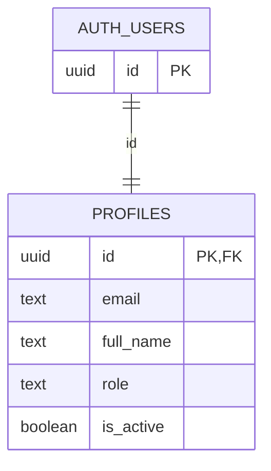

# 🔗 Database Relationships

Dokumen ini menjelaskan relasi antar tabel yang ditemukan pada database Kaizen Company Platform.

## 1. Application Relationship

Relasi aplikasi yang teridentifikasi secara eksplisit:

| Source Table | Source Column | Referenced Table | Referenced Column | On Delete | On Update |
|---|---|---|---|---|---|
| `public.profiles` | `id` | `auth.users` | `id` | CASCADE | NO ACTION |

Relasi tersebut menghubungkan profil aplikasi dengan akun autentikasi Supabase.

### Relationship Behavior

- **ON DELETE CASCADE:** Penghapusan akun pada `auth.users` akan menghapus record `profiles` yang memiliki ID terkait.
- **ON UPDATE NO ACTION:** Perubahan nilai referensi tidak dapat dilakukan apabila melanggar relasi tersebut.

## 2. Supabase Internal Relationships

Pemeriksaan pada schema `auth` juga menemukan foreign key internal Supabase, antara lain:

- `auth.identities` → `auth.users`
- `auth.sessions` → `auth.users`
- `auth.mfa_factors` → `auth.users`
- `auth.mfa_challenges` → `auth.mfa_factors`
- `auth.oauth_authorizations` → `auth.users`
- `auth.oauth_consents` → `auth.users`
- `auth.refresh_tokens` → `auth.sessions`
- `auth.saml_providers` → `auth.sso_providers`
- `auth.sso_domains` → `auth.sso_providers`
- `auth.webauthn_credentials` → `auth.users`

Relasi tersebut merupakan bagian dari infrastruktur Supabase Auth dan bukan relasi bisnis yang didefinisikan oleh aplikasi.

## 3. Relationship Inventory

| Scope | Foreign Keys Found |
|---|---:|
| `public` application relationship | 1 |
| `auth` internal relationships | 26 |
| **Total** | **27** |

## 4. Relationship Diagram

Diagram berikut hanya menggambarkan relasi aplikasi yang telah terverifikasi.

## 5. Important Notes

- Tidak ditemukan foreign key eksplisit lainnya di antara 12 tabel aplikasi pada hasil pemeriksaan.
- Hubungan logis antar tabel yang tidak menggunakan foreign key tidak digambarkan sebagai relasi database formal.
- Jangan menambahkan relasi berdasarkan asumsi nama kolom.
- Relasi internal Supabase tidak perlu dimodifikasi sebagai bagian dari perubahan skema aplikasi tanpa kebutuhan yang jelas.

---

**Source:** Foreign key metadata inspection pada schema `public` dan `auth`.
